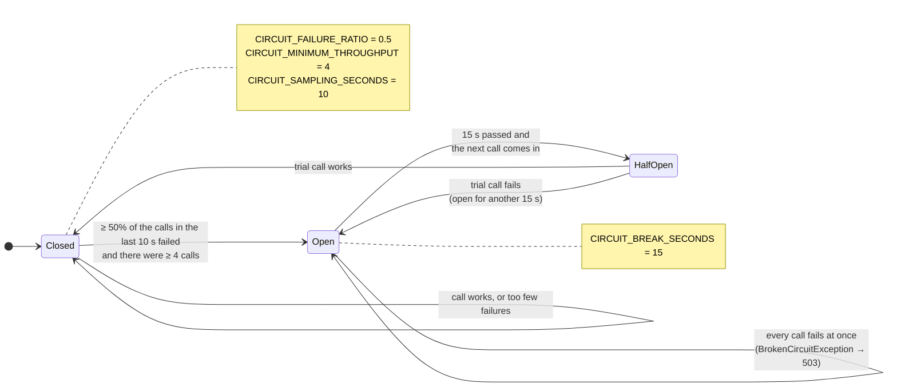
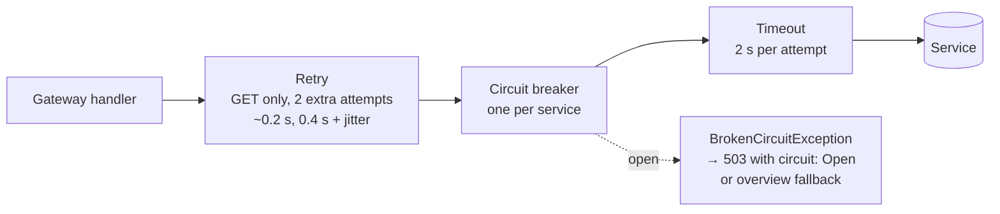

# Circuit breaker states

One circuit per service in the gateway (`services/ApiGateway/Resilience.cs`), and one in the
Member Service for its calls to the Loan Service. Values are the defaults from
`docker-compose.yml` / `.env.example` and can be changed with environment variables.

A **failure** is: no connection, the 2 second timeout (12 s for the Loan Service), or a
500/502/504 answer. A 503 and 4xx answers do not count.

## Where it sits in the pipeline

Every call goes through three Polly strategies. The outer one wraps the inner ones, so every
retry attempt passes through the circuit breaker and is counted there.

You can watch the state with `GET /api/diagnostics/circuits` (demo only,
`Gateway__EnableDiagnostics=true`) and in the logs (`docker compose logs -f api-gateway`).
Polly only moves from Open to HalfOpen when a call comes in after the break, so the endpoint
can show `Open` for a while after the 15 seconds are over.
