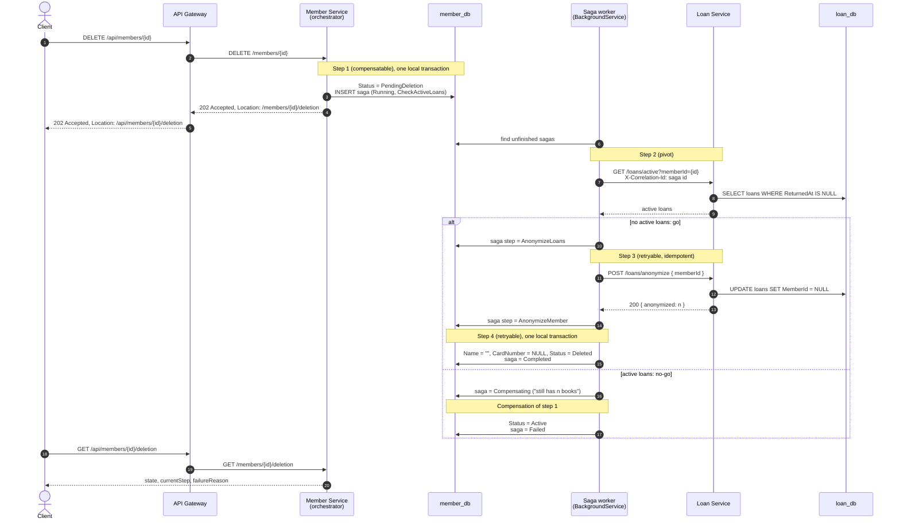
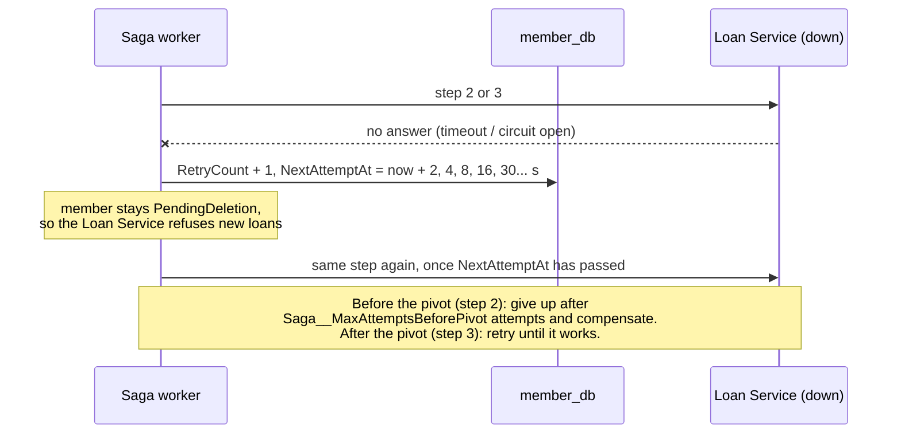

# "Delete member" saga

Orchestrated by the Member Service, over HTTP, without a message broker. The saga state is
saved in member_db after every step (`DeletionSagas` table), so the background worker can
continue it after a failure or a restart. Code: `services/MemberService/DeletionSagaRunner.cs`.

| # | Step | Service | Type |
|---|------|---------|------|
| 1 | Status → `PendingDeletion` | Member | compensatable |
| 2 | Any active loans? | Loan | pivot |
| 3 | Anonymize loan history | Loan | retryable |
| 4 | Anonymize member, status `Deleted` | Member | retryable |

## Happy path and compensation

## When the Loan Service cannot be reached

